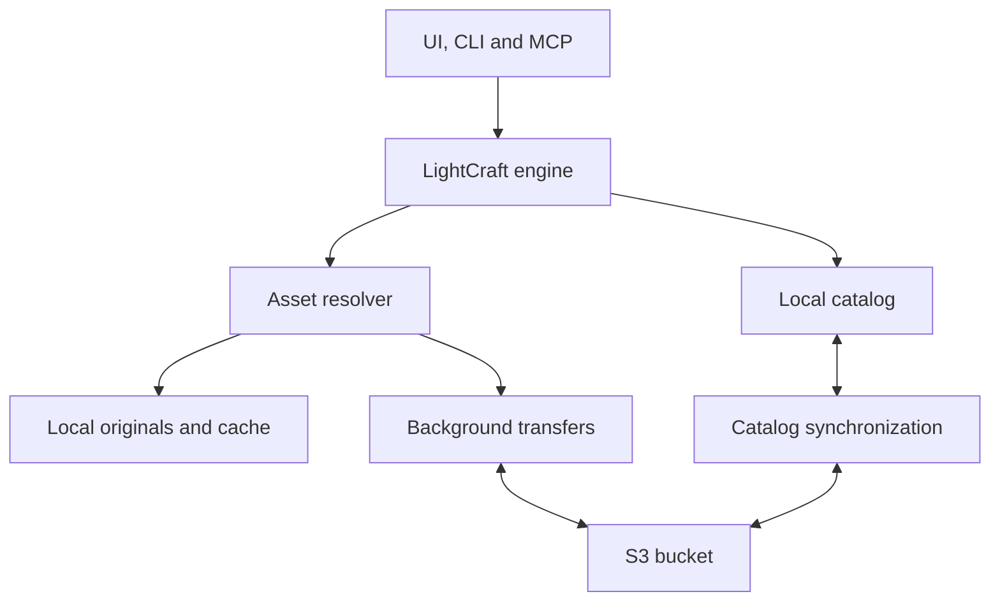

**Yes. S3 would be a good backing store, but making it feel seamless means adding an asset cache and background synchronization layer inside LightCraft.** The editor should request a photo at the quality it needs, and the storage layer should find it locally or download it automatically.

Assuming you mean [`storytold/lightcraft`](https://github.com/storytold/lightcraft), I reviewed its current source. It already has several useful pieces: injectable image loaders, a local catalog journal, thumbnail caching, and smart previews for editing while originals are unavailable. Those provide a reasonable foundation. [GitHub](https://github.com/storytold/lightcraft?utm_source=chatgpt.com)

There are two scopes to distinguish:

- **Cloud storage for one computer:** originals live in S3, and LightCraft caches them locally as needed.
- **One library across multiple computers:** originals, edits, ratings, albums, and other library data synchronize between devices.

The first is a fairly contained storage feature. The second adds a substantial synchronization project. I would design the asset layer to support both, then implement them in that order.

## 1. What LightCraft already has

These are the most relevant parts of the existing implementation and how I would use them:

| Existing component | What it does today | What cloud support would change |
|---|---|---|
| [`catalog/src/model.rs`](https://github.com/storytold/lightcraft/blob/76b5377868d912db69a777bda253a5b1b96b22bd/crates/catalog/src/model.rs) | A photo’s source is either `File { path }` or a generated demo. | Introduce a managed asset reference whose identity is independent of a filesystem path. |
| [`engine/src/files.rs`](https://github.com/storytold/lightcraft/blob/76b5377868d912db69a777bda253a5b1b96b22bd/crates/engine/src/files.rs) and [`media.rs`](https://github.com/storytold/lightcraft/blob/76b5377868d912db69a777bda253a5b1b96b22bd/crates/engine/src/media.rs) | File loading and probing use injectable callbacks; the underlying decoders can accept bytes. | Resolve cloud assets into cached files or bytes before calling the existing decoders. |
| [`engine/src/smart.rs`](https://github.com/storytold/lightcraft/blob/76b5377868d912db69a777bda253a5b1b96b22bd/crates/engine/src/smart.rs) | Creates editable source proxies for use when originals are offline. | Upload and cache these proxies so cloud libraries can become usable before all originals download. |
| [`preview/src/disk.rs`](https://github.com/storytold/lightcraft/blob/76b5377868d912db69a777bda253a5b1b96b22bd/crates/preview/src/disk.rs) | Maintains a bounded, disposable thumbnail cache. | Retain it, and add a separate original-file cache with stronger retention guarantees. |
| [`catalog/src/store.rs`](https://github.com/storytold/lightcraft/blob/76b5377868d912db69a777bda253a5b1b96b22bd/crates/catalog/src/store.rs) and [`journal.rs`](https://github.com/storytold/lightcraft/blob/76b5377868d912db69a777bda253a5b1b96b22bd/crates/catalog/src/journal.rs) | Saves catalog operations using a local journal and snapshots. | Keep local persistence, and add a durable protocol for uploading library changes. |
| [`engine/src/availability.rs`](https://github.com/storytold/lightcraft/blob/76b5377868d912db69a777bda253a5b1b96b22bd/crates/engine/src/availability.rs) | Checks whether an original exists, with a background cache. | Distinguish an uncached cloud original from a genuinely missing file. |

**The important catch is that LightCraft’s existing `Store` trait is specifically for catalog files.** It expects operations such as durable append, truncation, and atomic replacement. Implementing that trait over S3 would not cover original images, previews, sidecars, or the surrounding file-management behavior.

I would keep the catalog on local storage and introduce a separate abstraction for image assets.

## 2. The architecture I would use

For an initial version that talks directly to a user’s bucket:



The responsibilities are deliberately separate:

**The asset resolver** answers: “How can I obtain the pixels for this photo?”

**The transfer manager** downloads and uploads bytes, with progress, cancellation, retry, and integrity checking.

**Catalog synchronization** answers: “What changed in this library on another device, and how should those changes interact with mine?”

The UI and image-processing pipeline should mostly operate through the existing engine. Network activity belongs behind that boundary so the desktop app, CLI, and MCP commands all receive the same behavior.

### Keep three kinds of data separate

| Data | Where it should live |
|---|---|
| **Original image bytes** | Immutable objects in S3, with optional local originals and cached copies. |
| **Library state** | A local catalog, plus synchronized metadata: edits, ratings, flags, albums, keywords, versions, and asset references. |
| **Device state** | Local only: cache paths, download progress, cache budget, pinned files, selection, and hardware-specific preferences. |

An exposure adjustment should upload a small metadata change. Moving a photo between albums should update album membership. Neither operation needs to rewrite the RAW file.

## 3. Give photos an identity independent of their location

This is the first model change I would make.

A filesystem path currently serves several purposes: identifying a source, locating its bytes, finding sidecars, and determining whether it exists. Cloud storage needs those concerns separated.

Conceptually:

| Identifier | Meaning |
|---|---|
| `PhotoId` | A particular photo record, including its edits and metadata. |
| `AssetId` | The original asset that supplies its pixels. |
| `BlobId` | One exact, immutable version of the original bytes. |
| Local location | An original file or cached copy on this device. |
| Remote location | A storage connection, object key, and optionally an object version. |

A photo could therefore have its original in S3, a cached original on your desktop, and only a smart preview on your laptop. Its identity remains the same everywhere.

This also preserves virtual copies: several photo records can share an original while having different edits. LightCraft already models that relationship, so a content hash should not become the identity of the photo record itself. [Source: catalog model](https://github.com/storytold/lightcraft/blob/76b5377868d912db69a777bda253a5b1b96b22bd/crates/catalog/src/model.rs).

A reasonable extension would be something like:

```rust
// Conceptual design; not an existing LightCraft API.
enum Source {
    File { path: String },       // Existing local libraries
    Managed { asset_id: AssetId },
    Demo { scene: u32 },
}
```

The managed asset record would describe its original and available renditions. A separate local record would describe cached paths and retention state.

### Add a separate integrity hash

There is a subtle existing-code issue here: LightCraft’s current content hashing uses a noncryptographic 128-bit SipHash for duplicate detection and cache keys. I would preserve those existing semantics and introduce a separate SHA-256 field for immutable cloud content identity and verification. [Source: preview/hash.rs](https://github.com/storytold/lightcraft/blob/76b5377868d912db69a777bda253a5b1b96b22bd/crates/preview/src/hash.rs).

Also, an S3 ETag should be treated as a concurrency token, not assumed to be a file checksum. In particular, multipart uploads do not produce an ETag that is the MD5 of the complete file. [Amazon Simple Storage Service](https://docs.aws.amazon.com/AmazonS3/latest/userguide/checking-object-integrity-upload.html?utm_source=chatgpt.com)

## 4. Make the resolver understand the required image quality

The storage API needs to express more than “read this file.”

For example:

```rust
// Conceptual design.
enum SourceRequirement {
    PreviewAllowed,
    OriginalRequired,
}

async fn acquire(
    asset: AssetId,
    requirement: SourceRequirement,
) -> Result<AssetLease>;
```

`AssetLease` would provide access to verified local bytes or a local file and keep that content pinned until the caller finishes using it.

This is how I would expect normal operations to behave:

| User action | Expected behavior |
|---|---|
| Browse the library | Read local catalog records and cached thumbnails. |
| Open a photo | Show an available preview immediately; fetch a better source as needed. |
| Adjust exposure, crop, or color | Render locally using the available source and save edits locally. |
| Export at full quality | Acquire the original, then use the existing export pipeline. |
| Work offline | Allow operations supported by cached originals or smart previews. |
| Make an album available offline | Download and pin the requested originals or previews. |
| Free local space | Evict eligible cached copies while retaining cloud references. |

**“The original is not cached here” must be a valid state.** It should not send the user into the existing missing-file/relink workflow.

### Reuse LightCraft’s smart previews

LightCraft already has an editable proxy format, `.lcsp`. Its implementation describes approximately 1 MB proxies and supports editing and proxy-size export when an original is unavailable. The proxy codec already operates on bytes, although its current loading and discovery code uses local filesystem paths. [Source: smart.rs](https://github.com/storytold/lightcraft/blob/76b5377868d912db69a777bda253a5b1b96b22bd/crates/engine/src/smart.rs).

I would reuse that format for cloud storage:

1. Generate thumbnails and smart previews during import.
2. Upload them alongside the original.
3. Download catalog records and small previews when another device opens the library.
4. Download originals when an operation requires them, or through background prefetching.

Full-quality export needs an explicit policy. The current source-loading machinery can fall back to a smart preview when the original cannot be read. A cloud-aware export must distinguish “export from the preview” from “wait for the original.” It should never silently substitute the proxy for a requested full-resolution export. [Source: media.rs](https://github.com/storytold/lightcraft/blob/76b5377868d912db69a777bda253a5b1b96b22bd/crates/engine/src/media.rs).

### Keep network waits out of the UI thread

The existing loader callbacks are synchronous. I would schedule downloads before dispatching work that requires the original, then resume that work when the asset is available.

That avoids turning a local-looking function call into an unpredictable network stall.

There is also a concrete retry issue in the current UI: failed render requests can remain suppressed while their render key and catalog revision stay unchanged. Download completion therefore needs to invalidate the relevant availability/source state and retry the render; repainting alone may leave a photo stuck. [Source: ui-egui/render.rs](https://github.com/storytold/lightcraft/blob/76b5377868d912db69a777bda253a5b1b96b22bd/crates/ui-egui/src/render.rs).

## 5. Build a durable original-file cache and transfer queue

The existing thumbnail cache is disposable. Original images need stronger rules.

I would give the original cache:

- A configurable disk budget.
- Automatic eviction of unused, safely uploaded originals.
- Explicit “Keep available offline” pinning.
- Temporary pins while a decoder, export, or external editor uses a file.
- Deduplication of simultaneous requests for the same object.
- Download priorities: active photo, nearby photos, visible thumbnails, background work.
- Temporary download files that become usable only after verification.

The main invariant should be:

> An imported file that has not been safely uploaded is durable local data and cannot be evicted as cache.

The same applies to an externally edited working copy waiting to upload.

### Import and upload ordering

For a cloud-managed import, I would use this sequence:

1. Stage a durable local copy of the original.
2. Probe the image and generate its thumbnail and smart preview.
3. Save the local catalog record and its pending upload work.
4. Let the user start working immediately.
5. Upload the original and required supporting objects.
6. Verify successful storage.
7. Publish the remote catalog change that references those objects.
8. Mark the local work synchronized.

Publishing the remote catalog reference last is important. S3 provides strong read-after-write consistency and atomic replacement of individual objects, but it does not provide a transaction across an original, preview, and catalog record. [Amazon Simple Storage Service](https://docs.aws.amazon.com/AmazonS3/latest/userguide/Welcome.html?utm_source=chatgpt.com)

A successful upload followed by a failed metadata publication leaves an object that can be reconciled later. Publishing metadata before a required upload succeeds can leave another device with an unusable photo record.

For larger transfers, use multipart uploads and persist the upload ID and completed-part information so interrupted work can resume. Abandoned multipart uploads also need cleanup; their uploaded parts remain stored until completed or aborted. [Amazon Simple Storage Service](https://docs.aws.amazon.com/AmazonS3/latest/userguide/mpuoverview.html?utm_source=chatgpt.com)

The UI should distinguish **saved locally**, **uploading**, and **synchronized**. That gives the user a clear indication of whether a newly imported photo is already available on another device.

## 6. Synchronize library changes through a dedicated protocol

This is the largest additional piece if you want to open the same editable library on multiple computers.

LightCraft’s current journal is designed for local durability:

- It assigns sequential local operation numbers.
- It periodically replaces snapshots and compacts the log.
- The library uses a local lock to prevent competing writers.
- `Session::persist` clears pending operations after the local save succeeds.

Those properties are useful locally, but they do not make `catalog.log` a reusable multi-device change feed. [Sources: journal.rs](https://github.com/storytold/lightcraft/blob/76b5377868d912db69a777bda253a5b1b96b22bd/crates/catalog/src/journal.rs), [library.rs](https://github.com/storytold/lightcraft/blob/76b5377868d912db69a777bda253a5b1b96b22bd/crates/engine/src/library.rs).

### Add globally unique identities and mutation records

For multi-device creation, local counters are insufficient. Two offline devices must be able to create photos and albums without assigning conflicting identities.

I would introduce:

- A stable library ID.
- A device ID.
- Globally unique IDs for synchronized entities.
- A unique mutation ID for each persistent change.
- Base revisions for detecting concurrent changes.
- A durable remote synchronization cursor.

You could migrate existing IDs to UUIDs or retain the current compact IDs internally and add a persistent global-ID mapping.

Each mutation should describe the change and the revision it was based on. A retry must use the same mutation ID so it cannot accidentally duplicate an import, history entry, or album operation.

### Make the local save and sync intent one durable operation

This is a correctness requirement, not just queue management.

If the app saves an edit and then crashes before recording “upload this edit,” that edit can remain permanently local.

I would extend the journal/checkpoint format so it retains unacknowledged synchronization records alongside the catalog state. A separate transactional store is another option, but LightCraft does not need a database replacement simply to use S3.

Likewise:

- Compaction must retain unsent changes.
- Remote acknowledgements must be saved before pending work is discarded.
- Incoming changes and the received cursor must be saved together.
- A remote change should not be echoed back as a new local change.

The hook should cover all persistent mutation paths. LightCraft has changes from normal commands, system bookkeeping, undo, and redo; intercepting only UI commands would miss some of them. It also deliberately groups slider interactions into completed edits, which the sync layer should preserve. [Source: engine/lib.rs](https://github.com/storytold/lightcraft/blob/76b5377868d912db69a777bda253a5b1b96b22bd/crates/engine/src/lib.rs).

### Define conflict behavior explicitly

LightCraft currently has operations that replace entire develop settings, metadata structures, and album member lists. Blindly replaying competing replacements could discard work. [Source: catalog/lib.rs](https://github.com/storytold/lightcraft/blob/76b5377868d912db69a777bda253a5b1b96b22bd/crates/catalog/src/lib.rs).

For an initial implementation, I would use these policies:

| Concurrent changes | Proposed handling |
|---|---|
| Changes to different photos | Accept both. |
| Changes to different independent metadata fields | Merge against the shared base revision. |
| Two devices add different photos to an album | Preserve both additions using explicit membership operations. |
| Two devices develop the same photo | Preserve both recipes as separate versions when they conflict. |
| A delete conflicts with an offline edit | Retain enough information to recover the edit and resolve the conflict. |
| A device reconnects after a very long absence | Rebootstrap if it is older than the retained synchronization history. |

Deletion needs a retained tombstone—a record that the item was deleted—so an offline device does not recreate it later.

Undo also needs consideration: after receiving remote edits, applying an old inverse operation blindly could erase newer work. Undo should produce a new revision-aware change.

## 7. Can all of that live in S3?

**Yes, for a personal or bring-your-own-bucket version. A separate application server is optional.**

One possible bucket layout would be:

| Object key pattern | Contents |
|---|---|
| `libraries/<id>/objects/<sha256>` | Immutable originals. |
| `libraries/<id>/previews/<blob-id>/<format-version>.lcsp` | Editable source proxies. |
| `libraries/<id>/thumbs/<render-key>.jpg` | Thumbnails keyed by source, edits, and rendering parameters. |
| `libraries/<id>/catalog/changes/<batch-id>.json` | Immutable batches of library changes. |
| `libraries/<id>/catalog/checkpoints/<revision-id>.json` | Catalog checkpoints for efficient startup. |
| `libraries/<id>/catalog/head.json` | The currently published revision and references to its checkpoint/change history. |

The publication process would be:

1. Read `head.json` and its ETag.
2. Upload any required immutable objects and change batch.
3. Update `head.json` only if its ETag still matches the value you read.
4. If another device published first, fetch its changes and reconcile before retrying.

S3 supports this through conditional writes: `If-Match` for updating the version you read, and `If-None-Match: *` for creating an object only if it does not exist. A failed precondition signals a conflict; it should not trigger an unconditional overwrite. [Amazon Simple Storage Service](https://docs.aws.amazon.com/AmazonS3/latest/userguide/conditional-writes.html?utm_source=chatgpt.com)

The protocol still needs operation deduplication, checkpoints, conflict handling, and recovery rules. The bucket supplies storage and conditional object updates.

For a first implementation, polling the small catalog head is sufficient. Normal browsing should use the local catalog rather than repeatedly listing the bucket.

### When I would add a small backend

A metadata service becomes attractive when you want managed accounts, sharing, permissions, many devices, or a convenient incremental change feed.

That service could:

- Authenticate users.
- Accept revision-aware metadata changes.
- Record changes transactionally.
- Return changes since a cursor.
- Issue narrowly scoped upload and download URLs.

Photo bytes can transfer directly between the application and S3. Presigned URLs support that arrangement, so the metadata service does not need to proxy every RAW file. [Amazon Simple Storage Service](https://docs.aws.amazon.com/AmazonS3/latest/userguide/using-presigned-url.html?utm_source=chatgpt.com)

For your proposed bucket-backed functionality, I would start with direct S3 access and a clean boundary around metadata synchronization.

## 8. Audit every operation that currently assumes a local path

Opening and editing one cloud photo would prove the basic approach, but seamless support also requires these operations to work:

| Operation | Required cloud behavior |
|---|---|
| Original export, DNG conversion, merge, denoise | Acquire the appropriate original bytes through the resolver. |
| Rename and organize | Change logical names/folders for managed assets without moving large immutable objects. |
| XMP read/write | Address sidecars as associated assets rather than assuming a neighboring local file. |
| Edit in an external application | Materialize a pinned working file, then import/upload the returned revision. |
| Missing-photo detection | Treat confirmed deletion separately from an original that is merely uncached or temporarily unreachable. |
| Remove local copy | Evict a cached copy without deleting the library item. |
| Delete from library | Apply the library’s deletion policy and synchronize it. |

There are useful hooks already, but replacing only `FileLoader` would be incomplete. LightCraft also has a preview loader, a denoise pair loader, and `Media::file_bytes`, which serves operations that need original bytes. [Sources: media.rs](https://github.com/storytold/lightcraft/blob/76b5377868d912db69a777bda253a5b1b96b22bd/crates/engine/src/media.rs), [export.rs](https://github.com/storytold/lightcraft/blob/76b5377868d912db69a777bda253a5b1b96b22bd/crates/engine/src/export.rs).

I would also split the existing `Library::on_disk` decision into clearer capabilities. It currently helps control local caches and smart-preview directories as well as original-file behavior. A cloud-backed library still needs those local caches. [Source: library.rs](https://github.com/storytold/lightcraft/blob/76b5377868d912db69a777bda253a5b1b96b22bd/crates/engine/src/library.rs).

## 9. Rust implementation and browser support

For the native storage provider, I would evaluate the Rust [`object_store`](https://github.com/apache/arrow-rs-object-store) crate. It already provides an asynchronous object-storage interface with local, in-memory, and S3 implementations, including conditional operations. Keep it behind LightCraft’s own asset/transfer interfaces so application code does not depend directly on S3 concepts. [Rust](https://docs.rs/object_store?utm_source=chatgpt.com)

For authentication:

- A personal bucket can use an AWS profile or temporary credentials.
- User-supplied long-lived credentials, if supported, should live in the OS credential store.
- Access should be limited to the intended bucket or library prefix.

The AWS SDK for Rust supports a credential-provider chain and temporary credentials, which are useful building blocks for a native implementation. [AWS SDK for Rust](https://docs.aws.amazon.com/sdk-for-rust/latest/dg/credentials.html?utm_source=chatgpt.com)

**Browser support should be planned as an additional adapter.** LightCraft already uses browser storage and asynchronously loads originals through injected hooks, so there is useful precedent. However, its browser storage plumbing and smart-preview loading still need adaptation for cloud use. [Sources: web/store.rs](https://github.com/storytold/lightcraft/blob/76b5377868d912db69a777bda253a5b1b96b22bd/apps/lightcraft-web/src/store.rs), [web documentation](https://github.com/storytold/lightcraft/blob/76b5377868d912db69a777bda253a5b1b96b22bd/docs/web.md).

Also, `object_store` currently documents that its cloud features are unsupported on the browser’s `wasm32-unknown-unknown` target. A browser implementation could use `fetch` with authorized URLs while sharing the higher-level asset and synchronization logic. Browser access would also need the appropriate S3 CORS configuration. [GitHub](https://github.com/apache/arrow-rs-object-store?utm_source=chatgpt.com)

## 10. The implementation order I would choose

I would break this into four milestones, each producing a usable result.

### Milestone 1: Read cloud-backed originals

Add managed asset references, an S3 provider, and a verified download cache. Route the existing media readers through the resolver.

The acceptance case is simple: **a RAW file exists only in S3, and the normal LightCraft commands can open, edit, and export it.**

Also verify that reopening uses the cache and that an interrupted download never becomes a valid cached file.

### Milestone 2: Make it feel local

Add cloud thumbnails and smart previews, prioritized downloads, offline pinning, cache eviction, progress, and reliable retry after reconnect.

Verify that browsing remains responsive, cached content works offline, full-quality export waits for its original, and remote-only photos do not appear as missing.

### Milestone 3: Add safe cloud import

Add durable staging, upload queues, integrity checks, resumable transfers, and publication ordering.

Verify recovery after a crash at each stage, including the case where S3 accepted a request but the application never received the response.

At this point you have useful cloud storage even with only one local catalog.

### Milestone 4: Synchronize the library between devices

Add global identities, durable mutation records, catalog checkpoints, conditional publication or a metadata API, conflict versions, tombstones, and migration.

The important tests are two devices working offline, concurrent album changes, competing develops, deletes followed by reconnection, and compaction while changes are still waiting to upload.

**My first code change would be the managed asset reference and resolver, followed by that single cloud-only RAW acceptance case.** LightCraft’s existing decoders and smart previews should let you prove the storage design without a large image-processing rewrite. The substantial remaining engineering is in availability, durable background work, and synchronization.